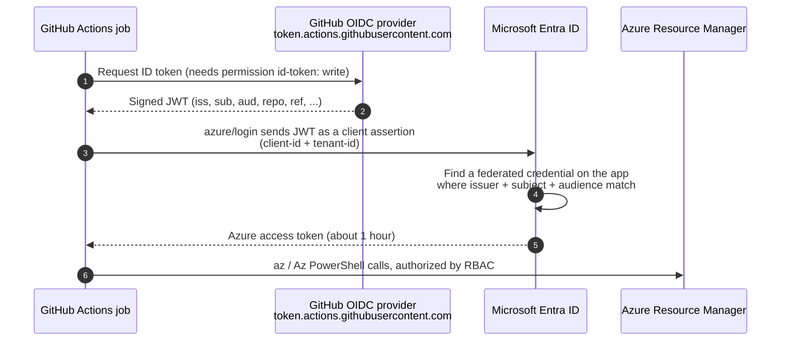

# Lab 0: Concepts

## The problem with secrets

The old way was to create a service principal **client secret** and paste it into a GitHub secret
(`AZURE_CREDENTIALS`). That secret lives for months or years, can leak, and you have to rotate it.

## The OIDC way

No secret is stored anywhere. Each workflow run proves who it is with a token that GitHub signs.

## Key terms

| Term | Meaning in this lab |
|------|---------------------|
| **App registration** | The identity object in Entra ID. Its *Application (client) ID* is `AZURE_CLIENT_ID`. |
| **Service principal** | The app's instance in your tenant. Azure RBAC roles are assigned to it. |
| **Federated identity credential** | A trust rule on the app: *"accept tokens from this issuer, with this subject, for this audience"*. You can add up to 20 per app. |
| **Issuer (`iss`)** | Always `https://token.actions.githubusercontent.com` for GitHub.com |
| **Audience (`aud`)** | `api://AzureADTokenExchange` (the default used by `azure/login`) |
| **Subject (`sub`)** | Describes *what is running*. It must match **exactly** (no wildcards). |

## Subject formats you will use

| Workflow context | `sub` claim |
|------------------|-------------|
| Job on branch `main` (no environment) | `repo:OWNER/REPO:ref:refs/heads/main` |
| Job that uses `environment: production` | `repo:OWNER/REPO:environment:production` |
| `pull_request` event | `repo:OWNER/REPO:pull_request` |
| Tag `v1.0.0` | `repo:OWNER/REPO:ref:refs/tags/v1.0.0` |

> **Important:** When a job uses an `environment`, the subject becomes the **environment** form,
> even if it runs on `main`. You will see this in Lab 3 and Lab 5.

## Do I store anything in GitHub?

Yes, but none of these values are secret. They are identifiers:

- `AZURE_CLIENT_ID`, `AZURE_TENANT_ID`, `AZURE_SUBSCRIPTION_ID`

This lab stores them as **repository secrets** (as the Microsoft docs do) so that they are masked in logs.
Repository variables would also work.

Next: [Lab 1: Set up the trust](01-setup-trust.md)
