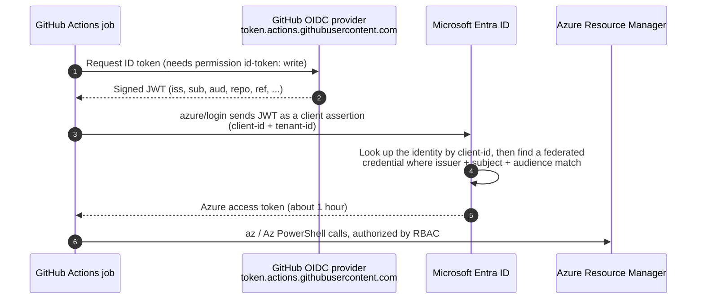

# Lab 0: Concepts

## The problem with secrets

The old way was to create a service principal **client secret** and paste it into a GitHub secret
(`AZURE_CREDENTIALS`). That secret lives for months or years, can leak, and you have to rotate it.

## The OIDC way

No secret is stored anywhere. Each workflow run proves who it is with a token that GitHub signs.



Note step 4: the **client-id** chooses *which Azure identity* to sign in as. The GitHub token is exactly the same
whichever identity you use.

## Two kinds of identity that can trust GitHub

|  | App registration + service principal (Lab 1) | User-assigned managed identity (Lab 2) |
|---|---|---|
| What it is | An application object in **Entra ID** | An **Azure resource** in a resource group |
| Permission needed to create it | Entra: create app registrations | Azure RBAC: *Managed Identity Contributor* on the RG |
| Can it have a client secret? | Yes. Avoid that. | **No, never.** |
| Federated credentials | Up to 20 | Up to 20 |
| Lifecycle | Lives until you delete it | Deleted when its resource group is deleted |
| Who can change its federated credentials | App owners and Entra admins | Anyone with write access on the identity resource (for example, Contributor on its RG) |
| `client-id` in `azure/login` | Application (client) ID | The identity's Client ID |

In both cases Azure RBAC roles are assigned to a **service principal**. A managed identity just has one that Azure
creates and manages for you.

## Key terms

| Term | Meaning in this lab |
|------|---------------------|
| **Federated identity credential** | A trust rule on the identity: *"accept tokens from this issuer, with this subject, for this audience"* |
| **Issuer (`iss`)** | Always `https://token.actions.githubusercontent.com` for GitHub.com |
| **Audience (`aud`)** | `api://AzureADTokenExchange` (the default used by `azure/login`) |
| **Subject (`sub`)** | Describes *what is running*. It must match **exactly** (no wildcards). |

## Subject formats you will use

Every subject starts with a **prefix** that names the repo. GitHub uses one of two formats:

| Prefix format | Example |
|---------------|---------|
| Classic | `repo:OWNER/REPO` |
| **Immutable** (includes numeric IDs) | `repo:OWNER@OWNER_ID/REPO@REPO_ID`, for example `repo:morakot-inta@73270904/Use-the-Azure-Login-action-with-OpenID-Connect@1420726188` |

With the immutable format, the trust breaks if someone deletes your account or repo and another person creates one with
the **same name**, because the new one gets a different ID. `OWNER_ID` is the ID of your user account, or of the
organization if the repo belongs to one.

**Don't guess the prefix.** Ask GitHub which one your repo uses (Lab 1, Step 0):

```bash
gh api repos/OWNER/REPO/actions/oidc/customization/sub --jq .sub_claim_prefix
```

In this lab, `<PREFIX>` means that value:

| Workflow context | `sub` claim |
|------------------|-------------|
| Job on branch `main` (no environment) | `<PREFIX>:ref:refs/heads/main` |
| Job that uses `environment: production` | `<PREFIX>:environment:production` |
| `pull_request` event | `<PREFIX>:pull_request` |
| Tag `v1.0.0` | `<PREFIX>:ref:refs/tags/v1.0.0` |

> **Important:** When a job uses an `environment`, the subject becomes the **environment** form,
> even if it runs on `main`. You will see this in Lab 4 and Lab 6.

## What gets stored in GitHub?

None of these values are secret. They are identifiers:

| Name | Value |
|------|-------|
| `AZURE_CLIENT_ID` | App registration's client ID (Lab 1) |
| `AZURE_MI_CLIENT_ID` | Managed identity's client ID (Lab 2) |
| `AZURE_TENANT_ID`, `AZURE_SUBSCRIPTION_ID` | Your tenant and subscription |

This lab stores them as **repository secrets** (as the Microsoft docs do) so that they are masked in logs.
Repository variables would also work.

Next: [Lab 1: Trust with an app registration](01-setup-app-registration.md)
