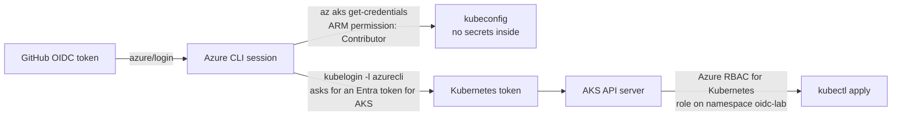

# Lab 8: Deploy to AKS with OIDC

Workflow: [`.github/workflows/07-deploy-aks.yml`](../.github/workflows/07-deploy-aks.yml)

So far, OIDC gave the workflow access to **Azure Resource Manager**. Now the same OIDC login goes one step further,
into the **Kubernetes API**, still without any stored secret or kubeconfig.



You will learn that there are **two layers of permission**:

| Layer | Controls | Role in this lab |
|-------|----------|------------------|
| Azure (ARM) | Can you *see* the cluster and download a kubeconfig? | Contributor on `rg-oidc-lab` (Labs 1 and 2) |
| Kubernetes (data plane) | What can you do *inside* the cluster? | **Azure Kubernetes Service RBAC Writer** on namespace `oidc-lab` (this lab) |

> **Cost:** One `Standard_B2s` node costs about USD 1 per day. Stop the cluster when you are not using it (Step 7).

## Step 1: Create the cluster

### 1.1 Install kubectl and kubelogin (once)

```bash
az aks install-cli        # may need sudo
# macOS alternative: brew install kubectl Azure/kubelogin/kubelogin
kubectl version --client && kubelogin --version
```

### 1.2 Create the AKS cluster (about 5–10 minutes)

```bash
az provider register --namespace Microsoft.ContainerService   # once per subscription

az aks create -g rg-oidc-lab -n aks-oidc-lab \
  --tier free \
  --node-count 1 --node-vm-size Standard_B2s \
  --enable-aad --enable-azure-rbac \
  --disable-local-accounts \
  --generate-ssh-keys
```

| Flag | Why |
|------|-----|
| `--tier free`, `--node-count 1`, `--node-vm-size Standard_B2s` | Cheapest setup for a lab. No quota for B2s? Try `Standard_D2s_v5`. |
| `--enable-aad` | Kubernetes logins go through Entra ID, the same place that accepts the GitHub OIDC token |
| `--enable-azure-rbac` | Kubernetes permissions are **Azure role assignments**, so you manage them with `az role assignment` |
| `--disable-local-accounts` | No static admin kubeconfig. See the note below. |

Portal: **Kubernetes services → Create → Kubernetes cluster**. On the **Basics** tab choose the cheapest options.
On the **Security** (or **Access**) tab, choose *Microsoft Entra ID authentication with Azure RBAC* and turn off
*local accounts*.

> **Why `--disable-local-accounts`?** Contributor includes `listClusterAdminCredential`. With local accounts enabled,
> your GitHub identity (Contributor on the RG) could run `az aks get-credentials --admin` and become
> **cluster-admin**, skipping all Kubernetes RBAC. You test this in Step 6.

### 1.3 Give yourself cluster admin

With Azure RBAC enabled, even the Owner of the subscription has **no** rights inside Kubernetes until a role is assigned.

```bash
AKS_ID=$(az aks show -g rg-oidc-lab -n aks-oidc-lab --query id -o tsv)
ME=$(az ad signed-in-user show --query id -o tsv)

az role assignment create \
  --assignee-object-id "$ME" --assignee-principal-type User \
  --role "Azure Kubernetes Service RBAC Cluster Admin" \
  --scope "$AKS_ID" -o table
```

### 1.4 Connect kubectl

```bash
az aks get-credentials -g rg-oidc-lab -n aks-oidc-lab --overwrite-existing
kubelogin convert-kubeconfig -l azurecli    # use your `az login` session to get Kubernetes tokens
kubectl get nodes
```

Look at `~/.kube/config`: there is **no password or certificate for you** in it, only an `exec` entry that calls `kubelogin`.

> `Forbidden` on `kubectl get nodes`? The role assignment from 1.3 can take 2–5 minutes to start working. Wait and try again.

So far **only you** have access. You give the GitHub identities access yourself in Step 3.

## Step 2: Create the namespace

The workflow may deploy only into this namespace.

```bash
kubectl create namespace oidc-lab
```

## Step 3: Give each GitHub identity access to the namespace only

```bash
AKS_ID=$(az aks show -g rg-oidc-lab -n aks-oidc-lab --query id -o tsv)
SCOPE="$AKS_ID/namespaces/oidc-lab"      # a namespace is a valid Azure RBAC scope
echo "$SCOPE"

APP_ID=$(az ad app list --display-name gh-oidc-lab --query "[0].appId" -o tsv)
SP_OBJECT_ID=$(az ad sp show --id "$APP_ID" --query id -o tsv)
MI_PRINCIPAL_ID=$(az identity show -g rg-oidc-lab-identity -n id-gh-oidc-lab --query principalId -o tsv)

for principal in "$SP_OBJECT_ID" "$MI_PRINCIPAL_ID"; do
  az role assignment create \
    --assignee-object-id "$principal" --assignee-principal-type ServicePrincipal \
    --role "Azure Kubernetes Service RBAC Writer" \
    --scope "$SCOPE" -o table
done
```

(If you did only Lab 2, skip the app registration lines and assign the role to `$MI_PRINCIPAL_ID` only.)

Check it:
```bash
az role assignment list --scope "$SCOPE" --query "[].{who:principalName, role:roleDefinitionName}" -o table
```

> Kubernetes RBAC assignments can take **up to 5 minutes** to start working. A `Forbidden` error right after this
> step usually means "wait a little".

## Step 4: Tell the workflow which cluster to use

GitHub: **Settings → Secrets and variables → Actions → Variables → New repository variable**:
`AKS_CLUSTER_NAME` = `aks-oidc-lab`

```bash
gh variable set AKS_CLUSTER_NAME --body aks-oidc-lab
```

## Step 5: Run the deploy with each identity

```bash
gh workflow run 07-deploy-aks.yml --ref main -f identity=app-registration
gh workflow run 07-deploy-aks.yml --ref main -f identity=managed-identity
```

Read the log:

1. **Get kubeconfig**: works because of the ARM role (Contributor).
2. **Deploy**: works because of the Kubernetes role (RBAC Writer on `oidc-lab`).
3. **What am I allowed to do?**: `yes` for the namespace, `no` for `kube-system`, namespaces and nodes.

See the app from your machine:
```bash
kubectl get pods -n oidc-lab
kubectl port-forward -n oidc-lab svc/hello 8080:80    # open http://localhost:8080
```

## Step 6: Experiments

1. **Login is not authorization.** Remove the RBAC Writer role from the managed identity
   (`az role assignment delete --assignee "$MI_PRINCIPAL_ID" --scope "$SCOPE"`) and run with `managed-identity`.
   `azure/login` and `get-credentials` still succeed, but `kubectl apply` fails with `Forbidden`.
   Create the role again when you are done.
2. **Admin credentials are blocked.** Add a step that runs `az aks get-credentials --admin ...`. It fails because
   local accounts are disabled. Why is that a good thing?
3. **Token lifetime.** Move the `Install kubectl + kubelogin` step to *after* `azure/login` and add `sleep 600` before
   `get-credentials`. What error do you get? (Hint: `AADSTS700024`, the client assertion has expired. Look at the
   token lifetime you found in Lab 4.)
4. **Challenge:** Change the Service to `type: LoadBalancer` and print its public IP in the job summary.

## Step 7: Save money

```bash
az aks stop  -g rg-oidc-lab -n aks-oidc-lab    # stops the node VMs; your setup is kept
az aks start -g rg-oidc-lab -n aks-oidc-lab
```

Deleting `rg-oidc-lab` in Lab 9 also deletes the cluster and its node resource group (`MC_rg-oidc-lab_...`).

Next: [Lab 9: Challenges & cleanup](09-challenges-and-cleanup.md)
