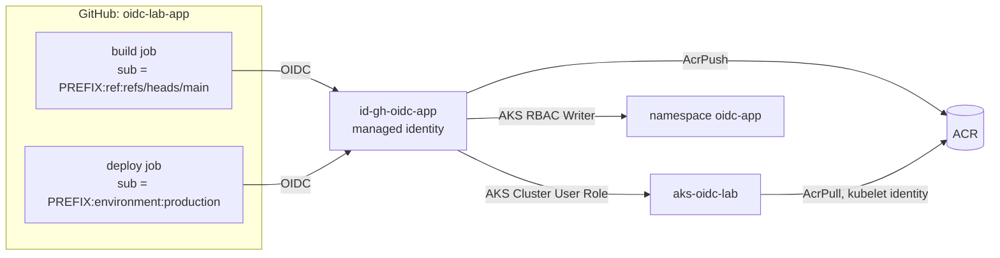

# Lab 9: A separate application repo

App repo: **[morakot-inta/oidc-lab-app](https://github.com/morakot-inta/oidc-lab-app)** (fork it, or create your own copy)

In real projects, the application lives in **its own repository**. In this lab you connect that repo to Azure the
right way:

- **One identity per repo.** The app repo gets its own managed identity, `id-gh-oidc-app`.
- **Least privilege.** That identity gets **no** Contributor role. It gets only the three roles the pipeline needs.
- **The subject names the repo.** A different repo has a different subject prefix (a different repo ID), so the
  identities from Labs 1 and 2 **cannot** be used from the app repo, and the other way round.



**Before you start:** Lab 8 is done (`aks-oidc-lab` is running and `kubectl get nodes` works).

> **Cost:** An ACR Basic registry costs about USD 0.17 per day.

## Step 0: Variables

```bash
source ~/oidc-lab.env                     # from Lab 1, Step 0
APP_REPO="morakot-inta/oidc-lab-app"      # your fork or copy
RG="rg-oidc-lab"
ID_RG="rg-oidc-lab-identity"
AKS_NAME="aks-oidc-lab"
LOCATION=$(az group show -n "$RG" --query location -o tsv)
SUB_ID=$(az account show --query id -o tsv)
TENANT_ID=$(az account show --query tenantId -o tsv)

APP_PREFIX=$(gh api "repos/$APP_REPO/actions/oidc/customization/sub" --jq .sub_claim_prefix)
echo "$APP_PREFIX"

# Save them for later sessions
cat >> ~/oidc-lab.env <<EOF
APP_REPO="$APP_REPO"
APP_PREFIX="$APP_PREFIX"
ID_RG="$ID_RG"
AKS_NAME="$AKS_NAME"
EOF
```

Compare `APP_PREFIX` with the `SUBJECT_PREFIX` of the lab repo (Lab 1, Step 0). The owner ID is the same, but the
**repo name and repo ID are different**.

## Step 1: Container registry

```bash
ACR_NAME="acroidclab$RANDOM"     # must be globally unique: 5-50 letters and digits only
echo "ACR_NAME=\"$ACR_NAME\"" >> ~/oidc-lab.env   # $RANDOM changes every time, so save it now
az acr create -g "$RG" -n "$ACR_NAME" --sku Basic -o table
ACR_ID=$(az acr show -n "$ACR_NAME" --query id -o tsv)
```

Notice that we do **not** enable the admin user (`--admin-enabled` is off by default). Nothing in this lab uses a
registry password.

## Step 2: Let AKS pull from the registry

```bash
az aks update -g "$RG" -n "$AKS_NAME" --attach-acr "$ACR_NAME"
```

This gives the cluster's **kubelet identity** the `AcrPull` role on the registry. Check it:

```bash
KUBELET_ID=$(az aks show -g "$RG" -n "$AKS_NAME" --query identityProfile.kubeletidentity.objectId -o tsv)
az role assignment list --assignee "$KUBELET_ID" --scope "$ACR_ID" --query "[].roleDefinitionName" -o tsv   # AcrPull
```

## Step 3: Namespace for the app

```bash
kubectl create namespace oidc-app
```

## Step 4: A managed identity for the app repo

```bash
az identity create -g "$ID_RG" -n id-gh-oidc-app -l "$LOCATION" -o none
APP_MI_CLIENT_ID=$(az identity show -g "$ID_RG" -n id-gh-oidc-app --query clientId -o tsv)
APP_MI_PRINCIPAL_ID=$(az identity show -g "$ID_RG" -n id-gh-oidc-app --query principalId -o tsv)
echo "$APP_MI_CLIENT_ID $APP_MI_PRINCIPAL_ID"
echo "APP_MI_CLIENT_ID=\"$APP_MI_CLIENT_ID\"" >> ~/oidc-lab.env
echo "APP_MI_PRINCIPAL_ID=\"$APP_MI_PRINCIPAL_ID\"" >> ~/oidc-lab.env
```

> **Why not reuse `id-gh-oidc-lab` from Lab 2?** If two repos share one identity, each repo gets the other's
> permissions. With one identity per repo, a problem in one repo stays in that repo.

## Step 5: Only the roles the pipeline needs

| Job step | Needs | Role | Scope |
|----------|-------|------|-------|
| `az acr login` + `docker push` | Push images | **AcrPush** | The registry |
| `az aks get-credentials` | Download a (non-admin) kubeconfig | **Azure Kubernetes Service Cluster User Role** | The cluster |
| `kubectl apply` | Change objects in one namespace | **Azure Kubernetes Service RBAC Writer** | `namespaces/oidc-app` |

```bash
AKS_ID=$(az aks show -g "$RG" -n "$AKS_NAME" --query id -o tsv)

assign() {
  az role assignment create \
    --assignee-object-id "$APP_MI_PRINCIPAL_ID" --assignee-principal-type ServicePrincipal \
    --role "$1" --scope "$2" --query "{role:roleDefinitionName, scope:scope}" -o table
}
assign "AcrPush"                                     "$ACR_ID"
assign "Azure Kubernetes Service Cluster User Role"  "$AKS_ID"
assign "Azure Kubernetes Service RBAC Writer"        "$AKS_ID/namespaces/oidc-app"
```

Compare it with the identity from Lab 2, which has Contributor on the whole resource group:

```bash
az role assignment list --assignee "$APP_MI_PRINCIPAL_ID" --all --query "[].{role:roleDefinitionName, scope:scope}" -o table
```

## Step 6: Federated credentials for the app repo

The two jobs in [`build-deploy.yml`](https://github.com/morakot-inta/oidc-lab-app/blob/main/.github/workflows/build-deploy.yml)
send two different subjects:

```bash
az identity federated-credential create -g "$ID_RG" --identity-name id-gh-oidc-app \
  --name gh-app-build-main \
  --issuer "https://token.actions.githubusercontent.com" \
  --subject "$APP_PREFIX:ref:refs/heads/main" \
  --audiences "api://AzureADTokenExchange" -o none

az identity federated-credential create -g "$ID_RG" --identity-name id-gh-oidc-app \
  --name gh-app-deploy-production \
  --issuer "https://token.actions.githubusercontent.com" \
  --subject "$APP_PREFIX:environment:production" \
  --audiences "api://AzureADTokenExchange" -o none

az identity federated-credential list -g "$ID_RG" --identity-name id-gh-oidc-app \
  --query "[].{name:name, subject:subject}" -o table
```

## Step 7: Configure the app repo in GitHub

In **oidc-lab-app → Settings**:

1. **Environments → New environment**: `production`. Add yourself as a **required reviewer**.
2. **Secrets** (Actions): `AZURE_CLIENT_ID` = `$APP_MI_CLIENT_ID`, plus `AZURE_TENANT_ID` and `AZURE_SUBSCRIPTION_ID`
3. **Variables** (Actions): `ACR_NAME`, `AZURE_RESOURCE_GROUP` = `rg-oidc-lab`, `AKS_CLUSTER_NAME` = `aks-oidc-lab`

```bash
gh api --method PUT "repos/$APP_REPO/environments/production" --silent
gh secret set AZURE_CLIENT_ID       --repo "$APP_REPO" --body "$APP_MI_CLIENT_ID"
gh secret set AZURE_TENANT_ID       --repo "$APP_REPO" --body "$TENANT_ID"
gh secret set AZURE_SUBSCRIPTION_ID --repo "$APP_REPO" --body "$SUB_ID"
gh variable set ACR_NAME             --repo "$APP_REPO" --body "$ACR_NAME"
gh variable set AZURE_RESOURCE_GROUP --repo "$APP_REPO" --body "$RG"
gh variable set AKS_CLUSTER_NAME     --repo "$APP_REPO" --body "$AKS_NAME"
```

> The `AZURE_CLIENT_ID` here is a **different** value from the one in the lab repo. Each repo knows only its own identity.

## Step 8: Ship it

Wait 2–5 minutes after Step 5 (Kubernetes RBAC needs time), then:

```bash
gh workflow run build-deploy.yml --repo "$APP_REPO"
```

Or change the text in `app/index.html` and push to `main`. Approve the `production` deployment when it asks.

Read the log:
1. **build**: `Federated token details` shows `...:ref:refs/heads/main`. `az acr login` works with no password.
2. **deploy**: a **new login** with a **new token**, and now the subject is `...:environment:production`.
3. Each job requests its own short-lived token. Nothing is passed between jobs except the image name.

See it:
```bash
az acr repository show-tags -n "$ACR_NAME" --repository hello-app -o table
kubectl port-forward -n oidc-app svc/hello-app 8080:80     # open http://localhost:8080 and check the Version
```

## Step 9: Experiments

1. **Repos can't borrow each other's trust.** In the app repo, set `AZURE_CLIENT_ID` to the lab's managed identity
   (`id-gh-oidc-lab`) and run the pipeline. You get `AADSTS700213`, because that identity trusts only the
   **lab repo's** prefix. Set the secret back afterwards.
2. **Least privilege works.** Add a step to the build job: `az group list -o table` and
   `az storage account create ...`. What does the app identity see, and what is it allowed to do?
3. **Namespace boundary.** Change `NAMESPACE` in the deploy job to `oidc-lab` (the Lab 8 namespace). Why does it fail
   with `Forbidden`?
4. **Only `main` can build.** Push a branch and run the workflow on it. Which job fails, and with which subject?
5. **Challenge:** Split the identity into two: `id-gh-oidc-app-build` (AcrPush only) and `id-gh-oidc-app-deploy`
   (AKS roles only), and use a different `client-id` in each job.

Next: [Lab 10: Challenges & cleanup](10-challenges-and-cleanup.md)
